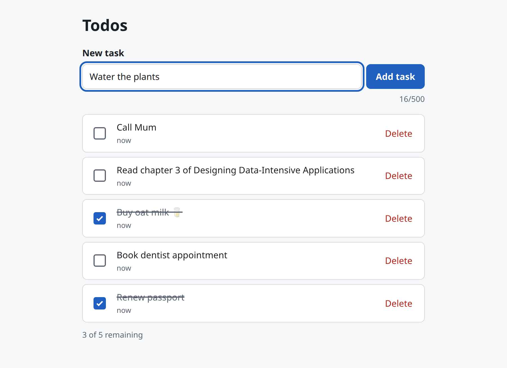
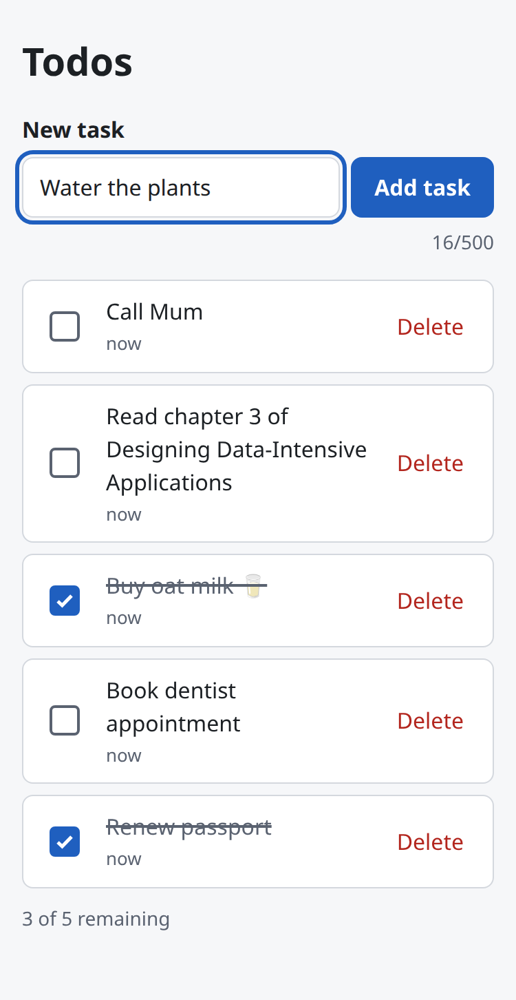
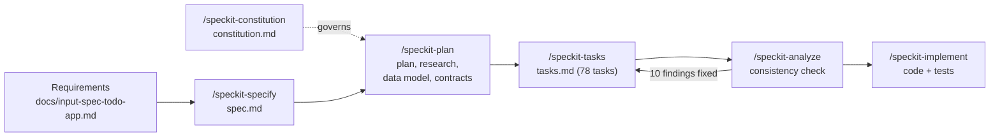

# Spec Kit Todo App

[](https://github.com/mehmetsunkur-labs/spec-kit-todo-app/actions/workflows/ci.yml)
[](LICENSE)

A worked example of **spec-driven development** with [GitHub Spec Kit](https://github.com/github/spec-kit)
and [Claude Code](https://claude.com/claude-code). It starts from a one-page requirements document and
ends with a tested full-stack app. Every step's artifact is committed, so you can follow how each
decision was made.

The app itself is deliberately small: a personal todo list. That keeps the focus on the process.

<p align="center">
  
  &nbsp;
  
</p>

## The workflow



| Step            | Command                 | Artifact                                                                                                                                                                                                                                                                                                                         | What happened                                                                                                                                                                                    |
| --------------- | ----------------------- | -------------------------------------------------------------------------------------------------------------------------------------------------------------------------------------------------------------------------------------------------------------------------------------------------------------------------------- | ------------------------------------------------------------------------------------------------------------------------------------------------------------------------------------------------ |
| 1. Requirements | —                       | [`docs/input-spec-todo-app.md`](docs/input-spec-todo-app.md)                                                                                                                                                                                                                                                                     | A one-page PRD: create, view, complete and delete todos; persistent; responsive; no accounts.                                                                                                    |
| 2. Specify      | `/speckit-specify`      | [`spec.md`](specs/002-todo-app/spec.md)                                                                                                                                                                                                                                                                                          | 4 prioritized user stories, 19 functional requirements, 7 measurable success criteria, edge cases. No technology choices yet.                                                                    |
| 3. Plan         | `/speckit-plan`         | [`plan.md`](specs/002-todo-app/plan.md), [`research.md`](specs/002-todo-app/research.md), [`data-model.md`](specs/002-todo-app/data-model.md), [`openapi.yaml`](specs/002-todo-app/contracts/openapi.yaml), [`ui-contract.md`](specs/002-todo-app/contracts/ui-contract.md), [`quickstart.md`](specs/002-todo-app/quickstart.md) | Stack chosen (TypeScript, Fastify, SQLite, React). 14 decisions recorded with the alternatives considered. API and UI contracts written before any code.                                         |
| 4. Constitution | `/speckit-constitution` | [`constitution.md`](.specify/memory/constitution.md)                                                                                                                                                                                                                                                                             | 5 project principles, including tests for every acceptance scenario, WCAG 2.1 AA, and justification for every dependency. The plan was then re-checked against them.                             |
| 5. Tasks        | `/speckit-tasks`        | [`tasks.md`](specs/002-todo-app/tasks.md)                                                                                                                                                                                                                                                                                        | 78 tasks grouped by user story, with tests written before the code they cover.                                                                                                                   |
| 6. Analyze      | `/speckit-analyze`      | (report)                                                                                                                                                                                                                                                                                                                         | A read-only consistency check across spec, plan and tasks found 16 issues. The 10 most important were fixed before coding.                                                                       |
| 7. Implement    | `/speckit-implement`    | the code                                                                                                                                                                                                                                                                                                                         | All 78 tasks done, test-first. Differences from the plan are recorded at the end of [`tasks.md`](specs/002-todo-app/tasks.md#implementation-notes-recorded-during-speckit-implement-2026-09-27). |

The commit history follows the same sequence, on the Spec Kit feature branch `002-todo-app`
(Spec Kit gives each feature a number).

## What the process caught

**Before any code was written**, `/speckit-analyze` found two design bugs that would have shipped:

- **The 500-character limit was counted two different ways.** The server counted Unicode code
  points, but the planned HTML `maxLength` counts UTF-16 units, so users could only have typed 250
  emoji. The fix was a code-point counter in the UI and no `maxLength`.
- **Fast clicks could leave the UI and server disagreeing.** With optimistic updates, two quick
  toggles could get responses back in the wrong order. The fix was to send at most one update per
  todo at a time, with the latest choice always winning.

**During implementation**, the tests caught two more:

- **Double-clicking Delete removed two todos.** After the first click, the next row's button slid
  under the pointer. Caught by an end-to-end edge-case test.
- **Todos created in the same millisecond came back shuffled.** The planned tiebreak sorted by random
  UUIDs. It showed up as a test failing in 2 of 8 runs, and was fixed with an insertion-order
  tiebreak and a database migration.

Each fix has a regression test.

## Results

| Check                                                    | Result                                                                                                                |
| -------------------------------------------------------- | --------------------------------------------------------------------------------------------------------------------- |
| Unit, contract, integration and component tests (Vitest) | 146 passing                                                                                                           |
| End-to-end tests (Playwright), at 320 px and 1280 px     | 46 passing                                                                                                            |
| API contract coverage                                    | Every documented response is tested; the run fails otherwise                                                          |
| Accessibility (axe, WCAG 2.1 AA)                         | No serious or critical issues in empty, populated, loading and error states; every control at least 44 × 44 px        |
| Speed with 500 todos                                     | List loads in about 300 ms (target 1 s); add, complete and delete show in 2–5 ms (target 100 ms); API p95 under 50 ms |

## How AI was used

Claude Code ran the Spec Kit commands and wrote the specs, code and tests. Claude also proposed
the technology stack during planning; each choice is recorded with its alternatives in
[`research.md`](specs/002-todo-app/research.md). I directed the process: I reviewed each step's
output, chose which analysis findings to fix, and approved the merge. Commits written with Claude
carry a `Co-Authored-By` line. The Spec Kit commands used are in
[`.claude/skills/`](.claude/skills/).

## Run it

You need Node.js 24 or later.

```bash
npm install
npm run dev          # API on :3000, app on http://localhost:5173
```

Production build:

```bash
npm run build
npm start            # one process on http://localhost:3000
```

Tests:

```bash
npm run lint         # ESLint and strict type-check
npm test             # Vitest suites and the contract-coverage check
npx playwright install --with-deps chromium   # once
npm run test:e2e     # Playwright, against a production build on port 3100
```

The [quickstart guide](specs/002-todo-app/quickstart.md) has manual checks for each user story and
an API smoke test. To try it with lots of data, run `npm run seed -w backend -- 500`.

Configuration is through environment variables (see [`backend/.env.example`](backend/.env.example)):
`PORT` (default `3000`), `DATABASE_PATH` (default `./data/todos.db`) and `LOG_LEVEL` (default `info`).

## Architecture

```text
shared/    Validation rules and API types, used by both sides
backend/   Fastify REST API, SQLite (better-sqlite3), SQL migrations
frontend/  React 19 + Vite single-page app, plain CSS
e2e/       Playwright suites
specs/     Spec Kit artifacts for the feature
```

- **API**: `GET/POST /api/todos`, `PATCH/DELETE /api/todos/:id`, `GET /api/health`, as specified
  in [`openapi.yaml`](specs/002-todo-app/contracts/openapi.yaml).
- **Instant UI**: changes appear before the server confirms them. A failed save rolls back only
  the affected todo, shows a message, and keeps any typed text.
- **Ready for accounts**: every query is scoped by an owner id. Adding sign-in means changing
  one function, `getOwnerId()` in `backend/src/todos/owner.ts`.

## License

[MIT](LICENSE)
